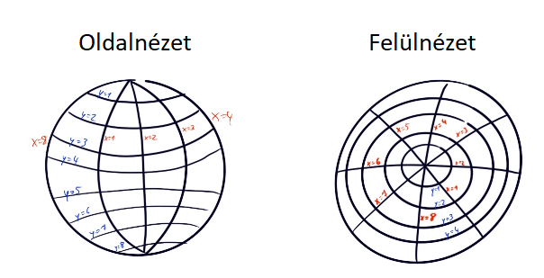

# Holdjáró – gömb alakú bolygó

A feladat a kapott ábra szerinti szélességi sávokat és hosszúsági szektorokat használja.



## Koordináták

- Alapértelmezés: 8 hosszúsági szektor és 8 szélességi sáv, 1-től számozva.
- Észak felé a `y` csökken, dél felé nő; kelet felé az `x` nő, nyugat felé csökken.
- A keleti és nyugati szélek összeérnek.
- A póluson átmenő lépés az első/utolsó szélességi sávban marad, a hosszúság fél fordulattal változik, az N/S nézési irány megfordul.
- Példa: `(1,1,N)` + `f` → `(5,1,S)`; `(3,8,S)` + `f` → `(7,8,N)`.
- A modell a sávok középpontjai közötti lépéseket írja le; a pólus külön mezőként nem szerepel.
- Más felosztásnál a hosszúsági szektorok száma pozitív páros szám, hogy a fél fordulat egész szektorra essen; a szélességi sávok száma pozitív egész.

## Parancsok és akadályok

`f`: előre; `b`: hátra, változatlan nézési iránnyal; `l`: balra; `r`: jobbra.
A pólus átlépése a földrajzi nézési irányt hátramenetben is megfordítja.
A parancsok sorrendben futnak. Ismeretlen parancsnál a teljes lista módosítás nélkül elutasítandó.
Az akadályt a gömbön kiszámolt célmezőn kell ellenőrizni, mozgás előtt. Akadálynál az utolsó szabad hely és nézési irány marad meg, a további parancsok nem futnak le.
A jelentés az akadály koordinátáit és a parancslistában elfoglalt, 0-tól számozott indexet tartalmazza.
Az induló mező nem lehet akadályos; az akadálylista a létrehozáskori térkép másolata.

```js
const rover = new Holdjaro({
    x: 1, y: 2, direction: 'N',
    width: 8, height: 8,
    obstacles: [[5, 1]]
});
rover.execute('ffr');
// { position: { x: 1, y: 1, direction: 'N' },
//   obstacle: { x: 5, y: 1, commandIndex: 1 } }
```

## Tesztelés

`npm run test:practice`, vagy a repó gyökerében:
`npx qunit gyakorlofeladatok/Holdjaro/Holdjaro.test.js`.
Minden `Rxx` teszteset külön RED commitban kerül be, utána külön GREEN commit teljesíti.
